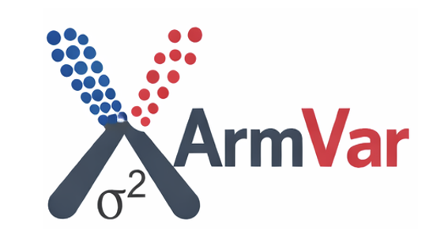

## Introduction 

`ArmVar` is an R package to detect cancer cells from single cell RNA sequencing (scRNA-seq) data. 

## Installation

To install ArmVar, run in R:

```         
remotes::install_github("mehdiretif/armvar")
```

## Usage

### Detect cancer cells

ArmVar can be used on Seurat object. A thyroid cancer dataset from [Gao et al. (Nat Biotechnol, 2021)](https://www.nature.com/articles/s41587-020-00795-2#citeas) is available as an example data. It can be loaded with:

```
library(armvar)

data("gao_2021_breast_cancer_data")
```

Then, ArmVar can be executed with:

```
armvar_res <- armvar(data = gao_2021_breast_cancer_data, k = 300, n_pcs = 50, n.cores = 3, heatmap = FALSE)
```


