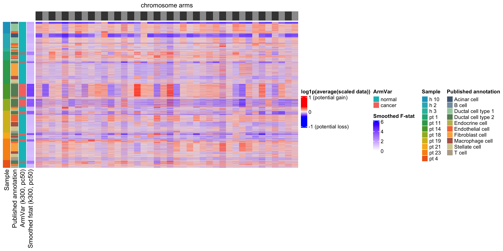
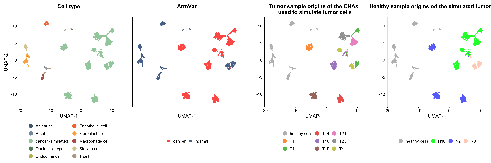

## Introduction 

`ArmVar` is a reference-free approach to identify cancer cells from single cell RNA sequencing (scRNA-seq) data by detecting Copy Number Alterations (CNAs). The method is based on a mean comparison test at the chromosomal arm-level using relative expression, in combination with a smoothing strategy.

## Installation

To install the package, run in R:

```         
remotes::install_github("mehdiretif/armvar")
```

## Usage

### Cancer cell identification

ArmVar can be used on a Seurat object. Some samples from [Peng et al. (Cell Res. 2019)](https://pubmed.ncbi.nlm.nih.gov/31273297/) are available as an example dataset. It can be loaded with:

```
library(armvar)
data("peng_2019_PDAC_sample")
```

Then, ArmVar can be executed with:
```
armvar_res <- armvar(data = gao_2021_breast_cancer_data, k = 300, n_pcs = 50, n.cores = 3, heatmap = FALSE)
```

The results of ArmVar (`armvar_res$data`) can be visualized using the standard `Seurat` plotting functions (`DimPlot`, `FeaturePlot`).


The function also returns a heatmap to visualize the mean comparison test by setting `heatmap = TRUE` in `armvar` or by executing:

```
hm_object <- generate_heatmap(armvar_res$data, geneMetadata = armvar_res$geneMetadata, heatmap_var <-  c('sample', 'published_annotation'))

ComplexHeatmap::draw(hm_object$heatmap, annotation_legend_list=hm_object$legend)
```


### Cancer tissue simulation

The package also proposes a pipeline to simulate cancer cells from healthy cells by inducing CNAs. The method is based on the calculation of fold changes between cancer and healthy cells for genes located in chromosomes arms with CNAs (according to [fastCNV](https://github.com/bioinfo-MUST/fastCNV) (a tool to identify CNAs in scRNA-seq data).

```
healthy_cells <- row.names(peng_2019_PDAC_sample@meta.data[peng_2019_PDAC_sample@meta.data$published_annotation == 'Ductal cell type 1' & peng_2019_PDAC_sample@meta.data$tissue == 'h',])
cancer_cells <- row.names(peng_2019_PDAC_sample@meta.data[peng_2019_PDAC_sample@meta.data$published_annotation == 'Ductal cell type 2',])

foldchange_computation_res <- foldchange_computation(peng_2019_PDAC_sample, healthy_cells, cancer_cells, sample_col='orig.ident', topNGenes=15000)
```

Then, the fold changes are used to induce the detected CNAs on healthy cells to simulate cancer cells. 

```
tumor_microenvrnt_cells <- row.names(peng_2019_PDAC_sample@meta.data[peng_2019_PDAC_sample@meta.data$tissue == "pt" & peng_2019_PDAC_sample@meta.data$published_annotation != 'Ductal cell type 2',])

simulated_seurat_obj <- cancer_tissue_simulation(data = peng_2019_PDAC_sample, sample_nb_to_simulate=8, cancer_cell_nb_to_simulate=320, total_cell_in_sample=400, healthy_cells_to_transform=healthy_cells, tumor_microenvrnt_cells=tumor_microenvrnt_cells, sample_fc_list= foldchange_computation_res$sample_fc_list,  sample_col='orig.ident', seed=1)
```

As explained previously, the simulated results in the Seurat object returned by the `cancer_tissue_simulation` function can be visualized using standard `Seurat` plotting functions.



For more explanation, a more complete tutorial can be found here: [How_to_use_armvar.Rmd](./vignettes/How_to_use_armvar.Rmd).
