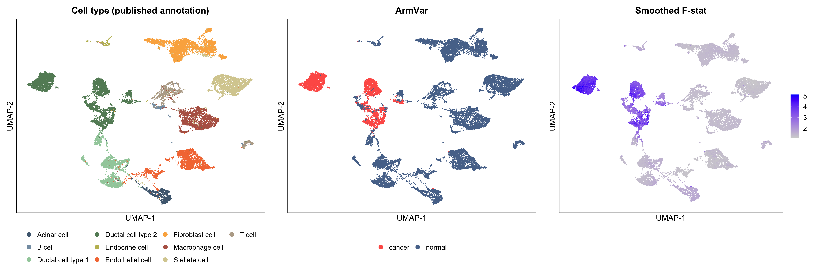

## Introduction 

`ArmVar` is a reference-free approach to identify cancer cells from single cell RNA sequencing (scRNA-seq) data by detecting Copy Number Alterations (CNAs). The method is based on a mean comparison test at the chromosomal arm-level using relative expression, in combination with a smoothing strategy.

## Installation

To install the package, run in R:

```         
remotes::install_github("mehdiretif/armvar")
```

## Usage

### Detect cancer cells

ArmVar can be used on a Seurat object. A thyroid cancer dataset from [Gao et al. (Nat Biotechnol, 2021)](https://www.nature.com/articles/s41587-020-00795-2#citeas) is available as an example data. It can be loaded with:

```
library(armvar)
data("gao_2021_breast_cancer_data")
```

Then, ArmVar can be executed with:
```
armvar_res <- armvar(data = gao_2021_breast_cancer_data, k = 300, n_pcs = 50, n.cores = 3, heatmap = FALSE)
```

The results of ArmVar (`armvar_res$data`) can be visualized using the standard `Seurat` plotting functions (`DimPlot`, `FeaturePlot`).


The function also returns a heatmap to visualize the mean comparison test by setting `heatmap = TRUE` in `armvar` or by using the executing:

```
hm_object <- generate_heatmap(armvar_res$data, geneMetadata = armvar_res$geneMetadata, heatmap_var <-  c('sample', 'published_annotation'))

ComplexHeatmap::draw(hm_object$heatmap, annotation_legend_list=hm_object$legend)
```


### Simulate cancer tissues

The method also proposes a pipeline to simulate cancer cells from healthy cells by inducing CNAs. **We highly recommend to use healthy counterparts of the malignant cells for the simulation.**

